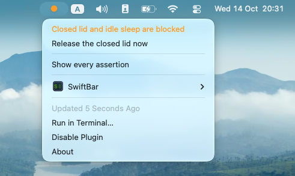

# opencode-keep-awake

Your Mac goes to sleep halfway through a long agent task.

This one keeps a Mac awake only while an [opencode](https://opencode.ai) session is actually working. As soon as the work ends, the Mac can sleep again.



While a session works, the menu bar dot turns orange. When nothing is working the dot is grey.

## Install

Tell your coding agent:

> Read https://raw.githubusercontent.com/loburets/opencode-keep-awake/main/INSTALL_FOR_AGENT.md and follow it.

If you want to read what it will do, the manual steps are in the [appendix](#appendix-manual-install).

## How it works

There are two parts:

- `plugin/keep-awake.ts` is an opencode plugin. It asks opencode whether any session is working and holds the power controls only while one is.
- `swiftbar/keepawake.10s.sh` is a [SwiftBar](https://github.com/swiftbar/SwiftBar) script. It reads the state from `pmset` itself, not from the plugin, so the icon stays accurate even if the plugin misbehaves.

**A locked screen does not stop work. System sleep stops it.** On a typical Mac it goes like this: the display sleeps after its timeout, which releases the assertion that `powerd` holds while the display is on, and then the system sleep timer fires. If your tasks die overnight, look at sleep, not at the screen lock.

### Level 1: open lid, no privileges

The plugin runs `caffeinate -i -m -w <server pid>` while any session works. That uses ordinary documented assertions and needs no privileges. It covers an open lid. It also covers a closed lid when an external display and power are connected, because with a display attached macOS already handles the closed lid and only idle sleep needs blocking.

This is enough for most people.

### Level 2 (optional): closed lid, no external display

`caffeinate` cannot stop lid-closed sleep under any combination of flags (details [below](#background)). The only thing that does is `sudo pmset -a disablesleep 1`. It is undocumented and needs root, so the plugin runs it through a sudoers rule that allows exactly two commands:

```
<you> ALL=(root) NOPASSWD: /usr/bin/pmset disablesleep 1, /usr/bin/pmset disablesleep 0
```

The rule allows those two literal commands with those exact arguments, and nothing else. sudoers matches arguments literally, so adding flags makes the command fall outside the rule. To remove it: `sudo rm /etc/sudoers.d/opencode-keepawake`. Without the rule the plugin simply runs Level 1.

On battery, the plugin holds the closed lid only while the charge is above 20%. You can change that with `OPENCODE_KEEPAWAKE_BATTERY_FLOOR`. Below the floor with the lid already closed, it lets go of the idle hold too, so nothing keeps a closed laptop running on its last charge.

## Limitations

- macOS only.
- **Run one opencode server at a time.** The `disablesleep` flag has no counter, so two servers running at once will fight over it.
- **The plugin treats `disablesleep` as its own.** While no session works it clears the flag, whoever set it. If you or another tool run `sudo pmset disablesleep 1` while an opencode server with this plugin is running, the plugin reverts it within about 15 seconds.
- **The flag survives a reboot and does not clear itself on a crash.** The plugin clears a leftover flag the next time it starts. To check or fix it by hand:
  ```
  pmset -g | grep SleepDisabled     # 1 means sleep is disabled
  sudo pmset disablesleep 0         # clear it
  ```
- A session waiting for your approval still counts as working, so the Mac stays awake while it waits. With the lid closed on battery, the battery floor ends it. With the lid open on battery, it lasts until macOS sleeps on its own low-battery warning. On power nothing ends it.
- A closed laptop running in a bag traps heat. Apple's guidance is about what the laptop sits on, not about the lid, but a bag has no airflow. Don't do it.
- `pmset disablesleep` is undocumented and could change in any macOS release.
- Written against the published opencode **1.x** plugin API and tested on opencode 1.19.0. The `sst/opencode` repository has moved to `anomalyco/opencode`, and its `dev` branch is a v2 rewrite with a different plugin interface. This plugin will need changes for v2.

## Safety rule

If the plugin cannot read or understand its source of activity, or the source does not answer within 5 seconds, it treats that as "nobody is working" and releases both holds. The same goes for the battery and lid readings: if one cannot be read, the plugin assumes the unsafe case and lets go. It never holds when it is unsure. The worst result of a format change should be that the feature quietly stops working, not a laptop that never sleeps and drains flat in a bag.

## Testing

```
node test/drive.mts
```

Needs Node 22.18 or newer, macOS, and the Level 2 sudoers rule. It drives the plugin with a fake opencode client and checks the results against real `pmset` output. **It changes the real `SleepDisabled` setting while it runs** and restores the value it found when it finishes. It refuses to run while a live copy of the plugin holds a guard, because that copy would change the flag under the test. The battery floor case runs only on battery power and is skipped on AC.

## Other agents

**Not implemented.** Only opencode is supported. The plugin keeps the activity source apart from the code that holds the power controls, so another tool could be added as a new source. These are notes for whoever does that.

**Claude Code** (checked on v2.1.299):

- Hooks are the wrong tool. `Stop` is documented as not firing when the user interrupts a turn, and `SessionEnd` is reported broken on Ctrl-C (anthropics/claude-code#9516, #32712). A hook-driven design would keep the Mac awake exactly when the user presses Esc and walks away, which is the worst case for this utility.
- There is no documented way to query whether it is working. Open feature requests: #38184, #52856.
- There is an undocumented per-process file, `~/.claude/sessions/<pid>.json`. It holds at least `pid`, `sessionId`, `cwd`, `version`, `status`, `statusUpdatedAt` and `messagingSocketPath`. `idle` has been seen as a `status` value, and other sources report `busy`, `waiting` and `shell`. The pid is both the file name and a field, so a file left behind by a killed process can be spotted by checking whether that pid is still alive, with no timeout needed.
- That file is an internal implementation detail. Anthropic has not promised to keep it stable, and its shape has already changed between versions. The safety rule above exists for sources like this.

**Codex CLI** (not tested, Codex was not installed where this was built):

- It has lifecycle hooks in `~/.codex/hooks.json` or a `[hooks]` table. Besides `UserPromptSubmit` and `SessionStart` for the start of work, there is a dedicated `Interrupt` event, which Claude Code lacks.
- It also has a real query interface. `codex app-server` speaks JSON-RPC over stdio or a Unix socket, and `thread/read` returns a `ThreadStatus` of `notLoaded`, `idle`, `systemError` or `active`, with the flags `waitingOnApproval` and `waitingOnUserInput`. The `thread/status/changed` notification pushes the same changes. The WebSocket transport is marked experimental.
- The older `notify` config key is a different, narrower mechanism: it has one event, `agent-turn-complete`, and passes its payload as the last argv argument rather than on stdin.

Supporting Claude Code would take a polling supervisor, because Claude Code has no plugin host for this code to live in. That means a LaunchAgent plus a small daemon, which is a redesign of the core rather than an addition. It would also remove the one-server limitation, since a single supervisor would own the flag instead of several plugins.

## Background

Why it is built this way:

1. **`caffeinate` cannot prevent lid-closed sleep.** Apple's documentation for `kIOPMAssertionTypePreventUserIdleSystemSleep` says: "The system may still sleep for lid close, Apple menu, low battery, or other sleep reasons." The open-source `caffeinate.c` maps its five flags onto ordinary assertion types, and the public IOKit API has no assertion type for the lid. Apple also documents the `-s` flag as deprecated since 10.9.
2. **Only `sudo pmset -a disablesleep 1` overrides lid-closed sleep without an external display.** It is missing from `man pmset`, is read through a private SPI, and works the same on Apple Silicon.
3. **That flag is not a power assertion.** It is a stored system setting with no owning process. It survives a reboot and is not cleared when the process that set it crashes. `caffeinate` behaves the opposite way, and this difference matters more than anything else in the project.
4. **Apple's supported closed-lid setup needs an external display, power, and an external keyboard or mouse.** With a display attached, closing the lid already works, and only idle sleep needs blocking.
5. **`client.session.status()` returns `{ [sessionID]: SessionStatus }`, and the server deletes a session from that map when it goes idle** (`packages/opencode/src/session/status.ts`). A non-empty map means something is still working, background subagents included. So there is no reference counting, no walking of `parentID`, and no special handling of `retry`.
6. **`SessionStatus` has three cases: `idle`, `busy` and `retry { attempt, message, next }`.** `retry` means waiting to retry after an API error, and it counts as working.
7. **A plugin must never wait on a call back into the opencode server during init.** The server answers no requests until every plugin has started, so waiting there deadlocks startup and opencode never opens. This happened and had to be fixed. The same goes for hooks.
8. **Never cache the state of the `disablesleep` flag.** It is global and anything on the machine can change it, so a cached value quietly drifts from reality. The plugin reads it with `pmset -g` before every write. This bug also happened.
9. **`caffeinate -i -m -w <serverPid>` releases its assertions by itself when the server dies, even on SIGKILL.** That is the dead-man switch for Level 1. The `disablesleep` flag has no such protection, which is why the plugin checks it and clears it when it starts.
10. **The plugin API changes in v2** (see Limitations).

## Appendix: manual install

These are the same steps the agent follows, with all the checks, in [INSTALL_FOR_AGENT.md](INSTALL_FOR_AGENT.md).

1. Copy `plugin/keep-awake.ts` to `~/.config/opencode/plugins/keep-awake.ts`. opencode loads it the next time it starts.
2. Install [SwiftBar](https://github.com/swiftbar/SwiftBar) and copy `swiftbar/keepawake.10s.sh` into its plugin folder, then `chmod +x` it.
3. Optional, Level 2:
   ```
   sed "s/__USERNAME__/$(id -un)/" sudoers/opencode-keepawake.template > /tmp/opencode-keepawake
   visudo -cf /tmp/opencode-keepawake
   sudo install -m 0440 -o root -g wheel /tmp/opencode-keepawake /etc/sudoers.d/opencode-keepawake
   sudo -n -k /usr/bin/pmset disablesleep 0 && echo ok   # -k: prove it works without a cached login
   ```
4. Restart opencode when it is not in the middle of anything.

To uninstall, delete those files and run `sudo pmset disablesleep 0`.

## License

MIT
